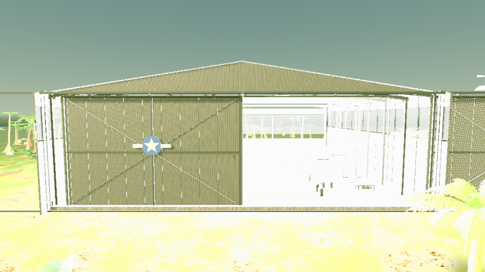
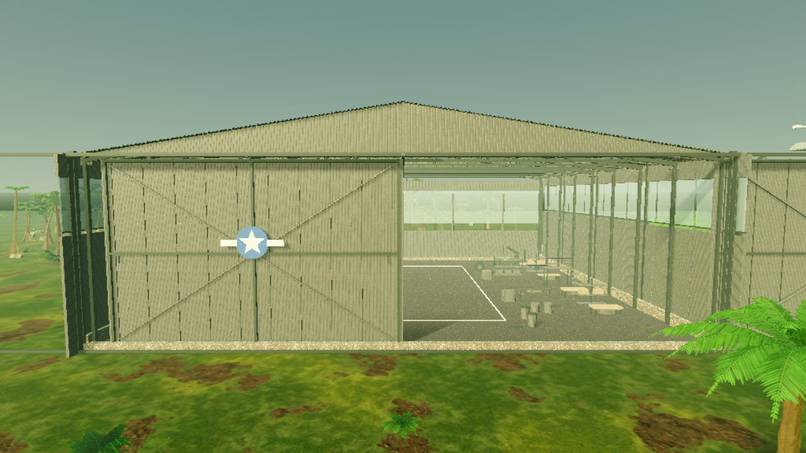
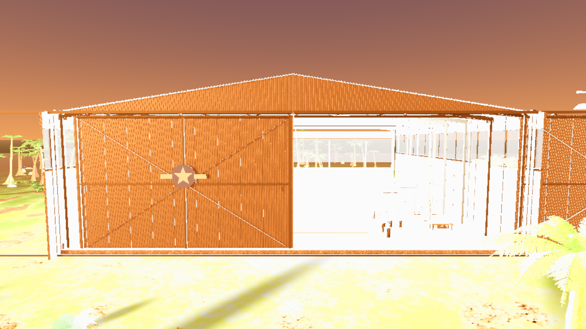
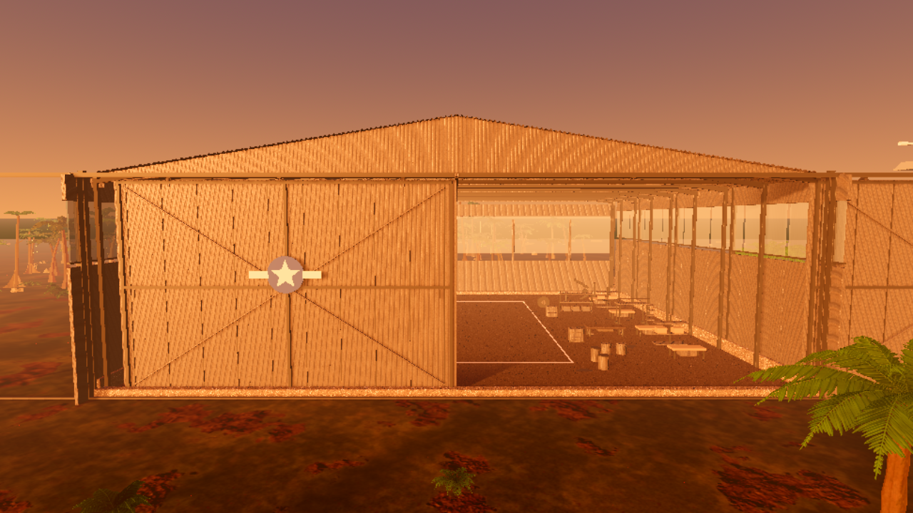
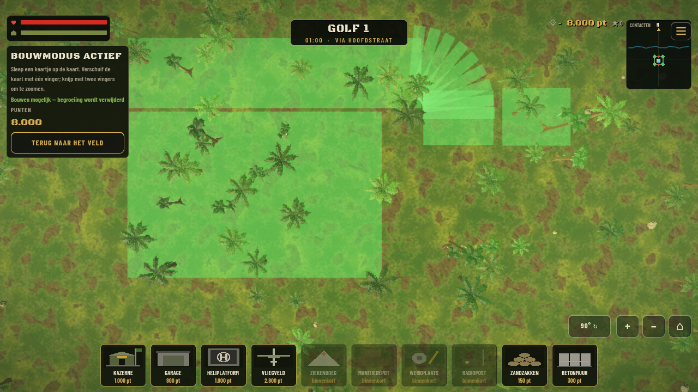
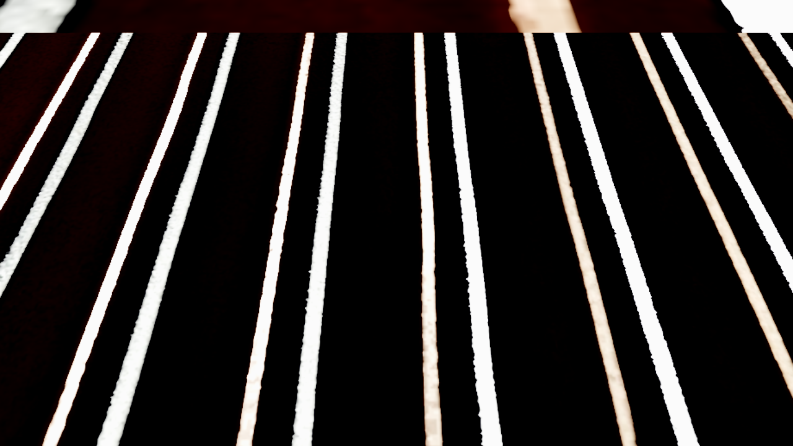
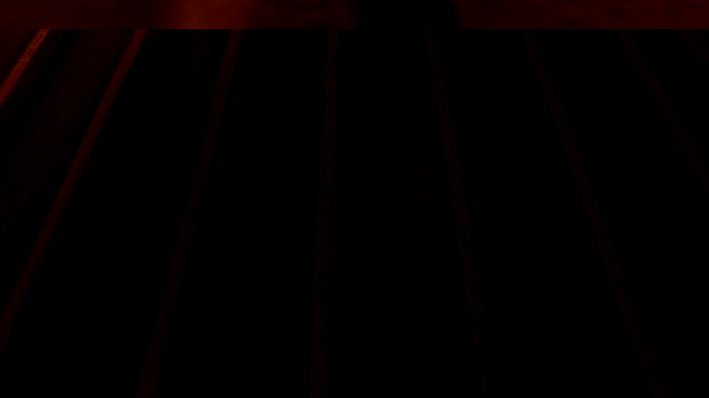

# Airfield HQ 2.3 — Lighting & visibility hotfix

## Change

The imported, approved HQ 2.2 LOD0 contains five `OmniLight3D` nodes named `Warm workshop practical light` (base name and four numbered copies). Each imports enabled with energy `38045.99` and range `4096 m`. Those values make the hangar lighting overwhelm the scene in the runtime build.

When a 2.3 airfield is instantiated, `AirfieldHQ23` now disables only those five matching LOD0 lights on that runtime instance. The source GLB and its authored lights remain unchanged; tower lights, warning-marker meshes, the hangar, its animations and collisions are untouched. The Airfield import test checks both that the source still has the five enabled lights at the imported values and that the placed 2.3 copy has all five disabled.

## Protected HQ 2.2 assets

The pre-change SHA-256 manifest contains 107 protected paths. Rechecking all entries after the hotfix returned 107/107 `OK` (`sha256sum -c docs/airfield_hq_v23/approved_2_2_sha256_before.txt`, exit 0). No protected HQ 2.2 model, scene, texture, animation or collision source was edited.

## Paired Godot captures

The before/after captures use the same production `main.tscn`, Compatibility renderer, 1280×720 viewport, fixed camera positions, weather and open-door states. The before run re-enables the five original runtime lights to reconstruct the pre-hotfix behavior; the after run uses the production fix. The green build preview is captured through the real build-menu flow. The gameplay capture includes the player placed inside the hangar.

| View | Before | After |
|---|---|---|
| Daylight |  |  |
| Twilight |  |  |
| Build-mode preview |  |  |
| Gameplay: player inside hangar |  |  |

The daylight and twilight views become readable after disabling the overpowered practical lights. Build preview appearance is unchanged. The gameplay view remains blocked by the roof, as expected from the separate visibility check below.

## Hangar roof visibility check

The fixed gameplay camera has no hangar-roof hiding behavior. A camera-to-player-head ray against a triangle-accurate temporary proxy of the approved hangar mesh hits the roof at about `Y=16.5 m`; the player is therefore occluded by the roof from the normal gameplay camera. The gameplay screenshot documents this. This hotfix records the finding and does not alter the protected hangar or introduce an unrequested roof-render change.

## Desktop measurements

Measured in the paired Godot capture run on an AMD Radeon R9 M395 with OpenGL Compatibility, 180 presented frames per run. These are desktop measurements, not iPhone results.

| Metric | Before | After | Difference |
|---|---:|---:|---:|
| Median FPS | 80.31 | 81.41 | +1.10 |
| 1%-low FPS | 56.16 | 55.40 | −0.76 |
| Median frame time | 12.452 ms | 12.283 ms | −0.169 ms |
| P99 frame time | 17.807 ms | 18.052 ms | +0.245 ms |
| Static memory | 232,546,697 B | 232,106,701 B | −439,996 B (about 0.42 MiB) |
| Peak static memory | 257,180,334 B | 257,179,290 B | −1,044 B |

The small changes are within desktop-run variation; the fix makes no 60 FPS claim. Draw calls were not captured by this harness. Native iPhone 18 Pro Max performance remains unmeasured.

Raw measurements: [`before/measurements.json`](before/measurements.json), [`after/measurements.json`](after/measurements.json).

## Verification

Passed locally with Godot 4.7.2:

- Cold editor import completed. A clean-cache pass emitted 12 existing zero-basis warnings while importing the unrelated `assets/brandkraan.glb`; after the import metadata/cache was primed, the strict second import and project startup completed with no `ERROR`, script or resource-load errors. No `brandkraan.glb` file is changed by this hotfix.
- `tests/airfield_hq_21_import_test.gd`: `AIRFIELD_21_GODOT_IMPORT_PASS`.
- `tests/airfield_hq_22_import_test_scene.tscn`: `AIRFIELD_22_GODOT_IMPORT_PASS`; 34 hangar meshes, 97 materials, 166,968 triangles, five imported workshop lights, zero enabled workshop lights in the placed 2.3 runtime copy, 13 collision modules and expected door/windsock animations.
- `tests/airfield_hq_23_contract_test_scene.tscn`: `AIRFIELD HQ 2.3 contract: PASS`; compact layout reports a 5,160.93 m² construction-area upper bound against the 6,452.44 m² limit and the 75 × 18 m runway.
- `tests/bunker_hq_replacement_test.gd`: pass.
- `tests/soldaat_vq2_test.gd`: pass.
- `tests/m1911_ammo_reload_test.gd`: pass.
- `tests/sloop_test.gd`: pass.
- `tests/ota_test.gd`: pass, including its expected invalid/missing-patch rejection paths.
- Protected HQ 2.2 SHA-256 inventory: 107/107 pass.

Godot reports invalid-resource-UID fallbacks for some imported GLBs and object/resource leak diagnostics during headless shutdown; relevant scene tests still exit 0 and print their pass markers. Each paired capture also logs four non-fatal `Lambda capture at index 0 was freed` diagnostics while the main game scene is running; both phases still write all screenshots, report their roof-ray result and exit 0. No automated test here measures native touch input or iPhone performance.

## Test execution notes

Capture scene: `tests/airfield_hq_23_lighting_visibility_capture_scene.tscn`, with `AIRFIELD_CAPTURE_PHASE=before` or `after`. The harness exercises the live build card, places the airfield, opens the hangar doors and records the roof ray and frame/memory samples. Screenshot evidence is stored alongside this report. The before phase only toggles the five target runtime lights to reconstruct the former state; it does not edit source assets.

## Release status

This report is tied to the hotfix feature branch and its Draft PR. Merge and OTA publication must wait for the PR checks to complete successfully. The native iPhone test is still required for device-specific visual, touch and performance acceptance.
