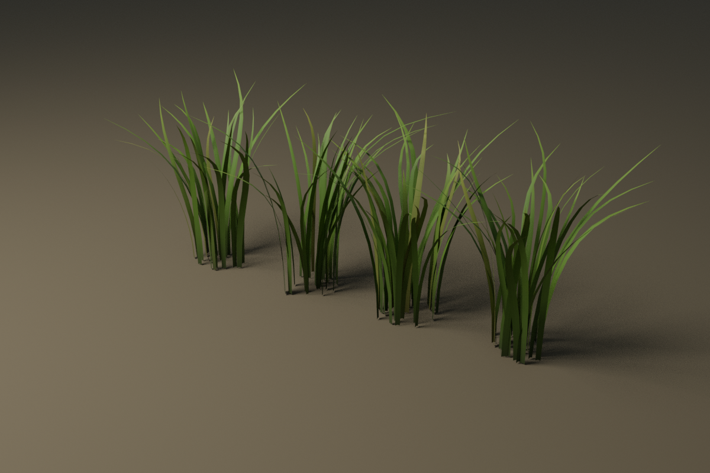

# Blender 3D-gras — drie hoogtes, vier varianten en echte 2K PBR

Branch: `feature/blender-grass-2k-three-heights`. Gestart vanaf main `ad6f47a`
(v126), daarna bijgewerkt met main `1397831` (v128: nieuwe palmen/rotsen en wapenclips). De verworpen, vlakker geworden belichting/grond uit PR #91 is **niet**
meegenomen. De bestaande levendige gamebelichting, grond, HUD en modellen blijven staan.

## Wat daadwerkelijk is gemaakt

In Blender 4.3.2 zijn twaalf individuele graspollen gebouwd. Iedere spriet heeft
een gebogen, taps toelopende vorm en een gevouwen middenrib. De volledige modellen
en beide lagere detailniveaus gebruiken echte geometrie, geen kruisende alphakaarten.

| Soort | Hoogte zonder kleine runtimevariatie | Varianten | Driehoeken per pol LOD0 | LOD1 | LOD2 |
| --- | --- | ---: | ---: | ---: | ---: |
| Kort | 10–25 cm | 4 | 400–520 | 120–156 | 42 |
| Middelhoog | 35–65 cm | 4 | 672–840 | 144–180 | 42 |
| Hoog | 90–140 cm | 4 | 1.080–1.296 | 240–288 | 42 |

De wereld varieert de schaal subtiel van 90 tot 108%. Elke pol heeft één oppervlak
en één gedeeld materiaal. LOD's gebruiken dezelfde seeded bladvormen/wortels en
verminderen het aantal sprieten/segmenten; de wortelpivot blijft op de grond.

### Bronbestanden en exports

- Bewerkbaar, native Blender-bestand: [bron/gras/gras.blend](../../bron/gras/gras.blend).
- Herhaalbare Blender-generator: [maak_gras.py](../../bron/gras/maak_gras.py).
- Negen echte GLB-bibliotheken: [assets/grass](../../assets/grass), drie hoogtes × drie LOD's.
  Iedere bibliotheek bevat de vier afzonderlijke varianten. De vier objecten staan
  alleen voor inspectie naast elkaar; runtime gebruikt hun lokale wortelpivots.
- Werkelijke GLB-statistieken en embedded-imagecontroles: [asset-report.json](asset-report.json).
- Native heropencontrole van de .blend: [blend-source-check.json](blend-source-check.json).

## Wat ‘2K’ hier betekent

De gedeelde materiaalset bevat **2048×2048 albedo, OpenGL normal en ORM** (AO,
roughness en metallic=0). De kaarten zijn op die resolutie procedureel opgebouwd,
met acht bladvarianten, lengtenerven, kleine cel-/pigmentdetails, donkere wortels,
lichtere punten en beperkt droog blad. Er is geen kleine afbeelding vergroot.

Dit zijn **originele procedurele PBR-kaarten, geen foto's of fotoscans**. Realisme
is de visuele doelstelling en blijft ter beoordeling van de gebruiker. Het aantal
pixels alleen bewijst geen fotorealistische kwaliteit. De atlas wordt door alle
twaalf varianten gedeeld; het zijn niet twaalf aparte geheugenzware 2K-sets.

De kaarten zitten gepackt in de .blend en in de standalone GLB's. De scoped
Godot-importer koppelt ze aan dezelfde drie externe texture-resources. Dat voorkomt
negen gedecodeerde kopieën in de game. Mipmaps en desktop/mobile VRAM-import zijn
vastgelegd. Bron en hashes: [provenance.json](../../assets/textures/grass_2k/provenance.json).

## Integratie in de bestaande game

De oorspronkelijke grasstap van `Foliage.plant()` levert de bestaande posities aan
`GrassField`. Die gebruikt een eigen RNG voor de nieuwe pollen. De oorspronkelijke
randomreeks voor bomen/rotsen blijft ongewijzigd en is onafhankelijk nagerekend.
Loop-/rijroutes, rivier, brug/ondiepte, stadsgebouwen en de basis worden ontzien.

- Kort en middelhoog gras staan in gemengde groepen buiten de basis.
- Hoog gras staat in vier onregelmatige velden, met kortere overgangen.
- De normale kaart bevat circa 6.200 korte, 2.200 middelhoge en 1.527 hoge pollen
  vóór kwaliteitsverdunning en afstandsculling. Dit zijn hele-wereld-aantallen.
- MultiMesh-batches delen meshes/materialen in vakken van 24 m. Er zijn geen losse
  nodes, colliders of physics-simulaties per spriet.
- Er is maximaal één zichtbaar LOD per batch. Keuze op camera-afstand: 36/49 m;
  einde op 52/62/72 m voor kort/middel/hoog, plus de normale frustumculling.
- De bestaande grafiek-/diagnoseknoppen en automatische kwaliteitstrap blijven
  actief. Hoog gebruikt de bestaande 45% grasdichtheid. Alleen Ultra kan nabij
  hoog gras echte schaduw laten werpen; de kwaliteitstrap schakelt dat weer uit.
- Het bestaande laadscherm warmt ook de gedeelde grasshader op.

### Wind en bewegen

De bestaande windkeuze stuurt de nieuwe shader. Bladpunten bewegen meer dan de
onderkant; de echte vertexgewichten zijn gecontroleerd op **nul bij iedere wortel**.
UV's en die kleurdata zijn ook na GLB-export en Godot-import gecontroleerd.
Vlak rond de speler buigt het gras visueel iets opzij. Dit verandert geen beweging,
hitdetectie of AI. Er zijn **geen GLB-animatieclips**: wind is een Godot-shaderbeweging,
die je werkelijk kunt afspelen in de Godot-showcase. De webviewer vermeldt dit eerlijk.

### Voorbereiding op later liggen/verbergen

De vier velddefinities staan in [resources/grass_zones.tres](../../resources/grass_zones.tres),
een mee-exporterende Godot-resource. `GrassField.zone_at(world_position)` geeft de
zone terug. `concealment_active` staat uit. Er is nu geen ligstand, onzichtbaarheid
of gewijzigde vijandelijke zichtcontrole. Dat wordt later apart gebouwd en moet
dan ook op alle grafische niveaus worden getest.

## Zelf bekijken en testen

### Working Copy / Xogot

1. Fetch en checkout **feature/blender-grass-2k-three-heights**. Main blijft ongewijzigd.
2. Laat de Godot-import afronden.
3. Open **scenes/grass_showcase.tscn** en speel deze scène. Je begint bij de twaalf
   pollen samen in de echte junglewereld.
4. Kies kort/middel/hoog of alle drie, Oud V1/Nieuw VQ2, Schuin/Gamecamera en Wind.
   Gebruik Loop zelf om de normale speler/touchbesturing te gebruiken.
5. Start **scenes/main.tscn** voor de echte game. Het eerste hoge veld ligt ten
   noordwesten van de basis, rond x=-12/z=-42. De hoofdroutes blijven open.

Beoordeel vooral silhouet, bladkleur, dichtheid, wind, leesbaarheid van de soldaat,
LOD-overgangen en FPS/resolutieschaal tijdens een drukke golf. Voor nauwkeurige
bladschaduwen kun je de bestaande boomschaduwkeuze ‘Echt’ vergelijken met ‘Vast’.

### Bestaande interactieve webviewer

De bestaande viewer in `tools/blender-vq2-viewer/` heeft drie grassecties gekregen,
ieder met vier varianten, LOD-keuze, 360° orbit, pinch, reset, materiaalinspectie en
V1/VQ2-vergelijking. De V1 is de **werkelijke oude drie-kaarten-mesh van 75 cm**,
omgezet naar een portable alpha-cut PBR-materiaal. De nieuwe korte/hoge types hebben
bewust een andere maat. Het is geen native 3D-renderer binnen de ChatGPT-chat.

Lokaal: start `python3 -m http.server 8000` in de repositoryroot en open
`http://localhost:8000/tools/blender-vq2-viewer/?asset=grass_tall`.

De privépreview wordt bijgewerkt op:
https://bloedjungle-vq2-modellen.whole-jam-7898.chatgpt.site/tools/blender-vq2-viewer/?asset=grass_tall

Zie [hosting-result.json](hosting-result.json) voor de bevestigde publicatiestatus
en eventuele verificatiebeperking. Meld zo nodig aan met hetzelfde ChatGPT-account.

## Echte renders en controles

Alle beelden komen rechtstreeks uit Blender, Godot of de echte WebGL-viewer;
geen AI-mock-ups. De vergelijkingsmontages bestaan uitsluitend uit die beelden.

| Soort | Blender oud | Blender nieuw | WebGL vergelijking |
| --- | --- | --- | --- |
| Kort | [PNG](renders/blender-short-old.png) | [PNG](renders/blender-short-new.png) | [PNG](renders/browser-short-compare.png) |
| Middel | [PNG](renders/blender-medium-old.png) | [PNG](renders/blender-medium-new.png) | [PNG](renders/browser-medium-compare.png) |
| Hoog | [PNG](renders/blender-tall-old.png) | [PNG](renders/blender-tall-new.png) | [PNG](renders/browser-tall-compare.png) |



- Godot-proefopstelling: [oud](renders/grass-plot-old.png) / [nieuw](renders/grass-plot-new.png),
  dezelfde camera, licht en ondergrond. De omringende wereld bevat in beide beelden
  de nieuwe grasscatter; de vergelijking betreft de twaalf proefpollen.
- Echte 58°/28m-gamecamera: [oud](renders/grass-gamecamera-old.png) / [nieuw](renders/grass-gamecamera-new.png).
- Geïntegreerd hoog gras: [normale camera](renders/grass-jungle-gamecamera.png) /
  [bestaande 48°/16m-gevechtscamera](renders/grass-jungle-combatcamera.png).
- Windframes: [A](renders/grass-wind-a.png) / [B](renders/grass-wind-b.png).
- [Opnamegegevens](godot-captures.json), [viewertest](viewer-test.json),
  [native broncontrole](blend-source-check.json), [verificatie](verification.json).

De nieuwe Godot-test controleert de echte geïmporteerde meshes, wortelgewichten,
2K-kaarten en gedeelde texture-identiteit, lagere driehoekaantallen per LOD, geen
overlappende LOD's, tall-zonegrenzen, geen grasphysics, behouden boom-/rotsposities,
de windkeuze en opruimen van de warm-up. De GL-run controleert bovendien echte
MultiMesh-transformreadback; de Dummy-renderer bewaart die niet.

## Prestaties en beperkingen

De drie gedeelde geïmporteerde desktopbeelden bevatten circa **10,67 MiB**
gecomprimeerde imagepayload inclusief mipmaps: [budget](texture-budget.json).
Dat is geen totale/residente iPhone-VRAM-meting. Mesh-/instancebuffers en andere
game-resources komen daar nog bij. De game tekent veel meer geometrie dan met de
oude zes-driehoeken-graskaarten; daarom zijn LOD's, batches, dichtheid en culling
onderdeel van deze uitvoering.

Native beelden/tests gebruiken Godot 4.6.3, OpenGL Compatibility en Mesa llvmpipe;
Blender-studiobeelden Cycles CPU. Het projectprofiel Forward+/iOS Mobile is niet
gewijzigd. Fysieke iPhone/Xogot-, Safari/Metal- en mobiele FPS-metingen zijn **niet
uitgevoerd**. Menselijke goedkeuring van de visuele kwaliteit staat nog open.
Bestaande gear-owner-/ObjectDB/resourcewaarschuwingen bij afsluiten blijven zichtbaar.

## Reproduceren

```sh
python3 tools/build_grass_textures.py
blender --background --threads 4 --python bron/gras/maak_gras.py
godot4 --headless --path . --editor --import --quit
godot4 --headless --path . -s tools/export_grass_baseline.gd
godot4 --headless --path . --editor --import --quit
python3 tools/verify_grass_assets.py
blender --background --threads 2 --python bron/gras/verify_source.py
blender --background --threads 4 --python tools/render_grass.py
GODOT=godot4 tools/run_tests.sh
BJ_INSTANT=1 godot4 --path . --rendering-method gl_compatibility \
  --windowed --resolution 1280x720 --fixed-fps 60 -s tools/capture_grass.gd
cd tools/blender-vq2-viewer
npm ci
npm run build
node test-grass.mjs
```

De game-dev CLI is niet geïnstalleerd; native Blender, Python/Pillow/Numpy en Godot
zijn rechtstreeks gebruikt. Er zijn geen betaalde providers of tool-wrapperreceipts
geclaimd. Werk staat op een featurebranch met Draft PR; **niet automatisch mergen**.
