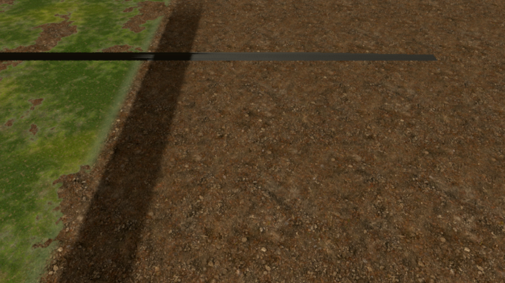
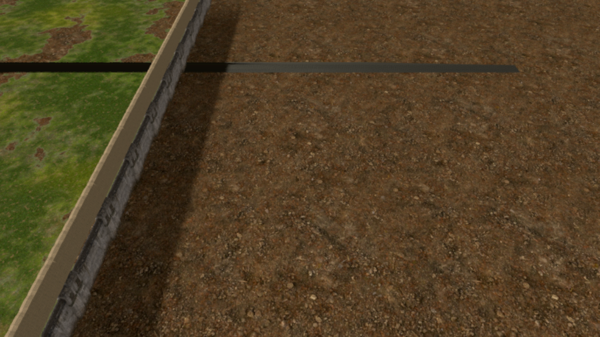

# Wall/terrain temporal stability follow-up

Base: `056b6d72bcf274b8b67756f8c32e6a28e2266ff9` (includes the previous terrain and mobile-wall fixes).

## Reproduction and changes

A camera at (-19.98, 14, 25), looking along the direction (0, -14, -15), starts around the west wall's 28 m LOD boundary. Independent begin/end hysteresis windows can initially hide both LOD0 and LOD1. The before capture reproduces the missing wall. Link LOD0 -> LOD1 -> LOD2 with `visibility_parent`, begin-only ranges and one hysteresis decision at each boundary. Give all three MultiMeshes identical enclosing bounds so they evaluate the same camera distance. Resolve the sibling paths after creating all three nodes.

The GLB already contains three authored LODs. Disable the additional importer-generated simplifications to prevent an extra, independent source of geometry changes. Mesh dimensions, materials, collision, gate positions and camera controls are preserved.

Enable 4x MSAA for high/ultra quality in the active viewport, including after quality changes. Low retains no MSAA. MSAA treats thin geometry edges; it does not filter texture shimmer. Apply a conservative +0.5 mip bias to terrain color, height and normal samples to prefilter high-contrast detail at reduced 3D resolution. Existing world anchoring and footprint-based detail fading remain.

## Evidence

Both captures: Godot **4.7.2**, Forward Mobile, 1280x720 output, 70% 3D scale, Mesa llvmpipe software Vulkan. Same ground textures, wall asset, sun and five camera positions moving 0.02 m along X per frame. These are isolated real-resource renders, not the complete game or native iPhone captures. The baseline used the original importer settings; final used the changed settings.

On the ground-only ROI x=[700,1200), y=[300,650), bilinearly reproject consecutive frames using the known flat-ground camera transform. Mean absolute RGB temporal residual (0..255): before **2.353664**, after **2.089567** over four frame pairs, approximately **11.2% lower**. This measures reduced fine texture variation in this scenario, not perceptual proof or an FPS result. A static horizontal band remains in both isolated renders; disabling ground shadow casting did not change it and that experiment was reverted.

Reproduce with `tests/surface_temporal_capture.gd`; set BJ_OUT to the destination and BJ_MSAA=4 for the candidate. BJ_BASELINE=1 restores the independent range windows and zero texture bias; for an exact legacy mesh baseline also restore/reimport the original GLB import setting. Use the same renderer, size and camera trajectory. On this host the default software render thread blocked even on a single-box probe; captures used the experimental `--render-thread separate` option and reached frame_post_draw/image readback. The engine logged a render-thread-finalize error on shutdown. This option is **not** changed in the game.

## Regression validation

- `base_wall_hq2_test.gd`: shared bounds enclose every module, visibility-parent chain stays within each span, begin-only hysteresis, original collision/projectile/gate/explosion regressions.
- `surface_filtering_test.gd`: actual viewport MSAA across high -> low -> ultra -> low -> high; terrain resource mipmaps.
- Surface test is required in the iOS workflow and fails on missing PASS, script errors or engine errors.
- Local import and both headless regressions pass in Godot 4.7.2. GitHub iOS and OTA preview must pass before release.

Native iPhone/iPad visual acceptance and GPU/memory cost of 4x MSAA: **NOT TESTED**. No physical phone is connected. Software-renderer timings are not hardware performance measurements.

Additional GPU pixel regression: `tests/base_wall_lod_render_test.gd` builds only the west span, renders it unshaded white, opens a fresh wall at camera distances 26/28/29/30/56/58/59/60/29/58 m, and checks the centre 20x20 pixels contain wall geometry. This checks actual coverage on both thresholds rather than relying on `visible` (which ignores renderer range culling). Candidate passes all ten positions (136–389 white pixels). `BJ_LEGACY_LOD=1` restores independent windows for the negative control. Optional BJ_LOD_OUT retains frames. The test refuses a headless/dummy-renderer PASS.
Negative control result: legacy independent windows fail **6/10** starting positions (28,29,58,59,29,58 m produce zero wall pixels); linked candidate passes **10/10**. Both use the same imported mesh, camera trajectory and pixel ROI, isolating range logic from texture changes.
