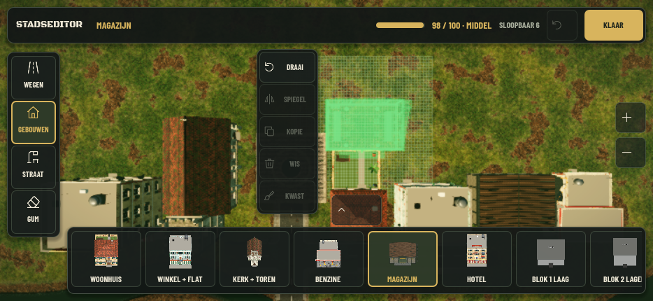
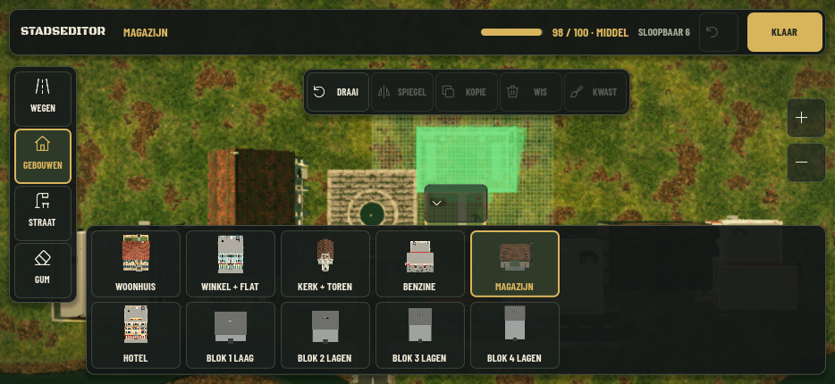

# Stadseditor 2.0 — v85

Gebouwd vanaf main `ca282ca` (v84, inclusief het militaire magazijn, vernieuwd straatmeubilair, brandkranen en avondverlichting). De tekstuele Stadseditor 2.0-opdracht is leidend; de aangeleverde screenshot toont de vorige editor.

## Bediening

- Open **Stadseditor** tussen de golven via het bestaande menu of F8.
- Kies links **Wegen**, **Gebouwen**, **Straat** of **Gum**. De bibliotheek volgt automatisch `Stad.ORDER` en `Stad.available()`.
- De greep doorloopt **compact → uitgebreid → verborgen → compact**. Compact is standaard. Veeg horizontaal door de kaarten; een veeg kiest geen kaart.
- Een gebouw krijgt zijn echte GLB als transparante preview, zonder gameplay, botsingen of schaduwen. Groen betekent geldig, rood ongeldig. Het bestaande raster en `Stad.problem()` bepalen de plaatsing.
- Tik om te plaatsen; selecteer en sleep een bestaand object om het te verplaatsen. Veeg met een gekozen bouwobject om de kaart te verschuiven. Twee vingers verschuiven en zoomen de kaart. Een tweede vinger annuleert een begonnen plaatsing of kwaststreek.
- Het objectgereedschap blijft binnen de veilige schermruimte. **Draai** draait een selectie direct 90°. **Spiegel**, **Kopie**, **Wis** en **Kwast** behouden hun bestaande toepassingsgebied. Gebouwen kunnen volgens de bestaande spelarchitectuur niet spiegelen; die knop is dan uitgeschakeld. Wegen en straatobjecten kunnen wel spiegelen.
- De bovenbalk toont de werkelijke stadsbelasting en het aantal sloopbare gebouwen. **Ongedaan** herstelt de laatste bewerking, **Klaar** sluit de editor. De titel **STADSEDITOR** opent de bestaande export/herstelopties.
- R: draaien, M: spiegelen, K: kwast, Ctrl/Cmd+Z: undo, Delete: wissen. F3 toont bestaande diagnostiek als die in de instellingen aanstaat; normaal blijft deze verborgen.

De opslag blijft `stad_editor.json` met dezelfde `basis` en `items`. Werelddata, gebouwmodellen, gameplaycamera, destructie en grafische instellingen zijn niet gewijzigd door deze PR. Kaarten, texturen, stijlen en lijniconen worden hergebruikt; er draaien geen 3D-viewports voor de kaarticonen. De tien gebouwiconen zijn eenmalig opnieuw gerenderd op 256×256 vanuit de actuele modellen.

## Technische controles

Godot **4.7.2**, Linux. De editorintegratietest gebruikt de echte hoofdscène en een afzonderlijk test-savebestand. Zowel headless als in een echt X11-venster gecontroleerd; fysieke Windows- en iPhone-apparaten zijn hier niet beschikbaar.

```sh
godot --headless --editor --path . --quit
godot --headless --path . -s tests/stad_editor_2_test.gd --fixed-fps 60
godot --headless --path . -s tests/stad_editor_test.gd --fixed-fps 60
```

`stad_editor_2_test.gd` voert **2.814 controles** uit, onder meer categorieën, hergebruik van kaarten, drie paneelstanden, echte GLB-preview, geldige/ongeldige plaatsing, muis- en touchplaatsing, verplaatsen, draaien, spiegelen, kopiëren, wissen, kwast, annuleren bij pinch of een OS-annulering, horizontaal vegen zonder onbedoelde selectie, undo, wegen met bochten/T/kruisingen, opslag en herladen, belasting, verborgen/herstelde HUD, openen/sluiten en bestaande spelregels.

Layout wordt gecontroleerd op **934×430, 844×390, 736×414 en 1280×720**, met objecten bij alle schermranden, alle paneelstanden en gesimuleerde notch/home-indicator. Controles omvatten paneeloverlap, inhoud van de bovenbalk, veilige schermranden en aanraakvlakken van minimaal 44 punten. De headless Window-server levert geen muis-enter; alleen die OS-melding wordt daar gesimuleerd. Dezelfde test draait ook met een echt Godot-venster.

Daarnaast zijn 25 bestaande regressies uitgevoerd: stad, stad_editor, stad_lijn, stad_menu, hud_layout, camera, besturing, stick, bouw, smoke, magazijn, magazijn_dak, hotel, kerk, benzine, huis, winkel, ai, tank_mik, granaat, meubels, explosie, schade, loadout en brandkraan. De oudere editortest heeft nu echte foutcontroles en volgt het directe draaien via de contextknop.

Resultaten staan in [controles.json](controles.json). Godot meldt bij het afsluiten van wereldtests nog bestaande ObjectDB/resource-waarschuwingen (`9 resources still in use at exit`). Dit is ook afzonderlijk gereproduceerd op ongewijzigde main `ca282ca`; er zijn geen parsefouten, ontbrekende resources of fouten in de afgeronde editorcontroles. De softwaredriver ondersteunt geen VSync-wijzigingen; projectinstellingen zijn niet aangepast.

De eerste import van de zojuist op main toegevoegde `brandkraan.glb` meldde een preload voordat de GLB-loader klaar was en nul-basiswaarschuwingen uit het model. Beide zijn afzonderlijk gereproduceerd op ongewijzigde main `ca282ca`. Nadat Godot de assets had geïmporteerd, eindigde een volgende import zonder script- of resourcefouten, op zowel main als deze branch. De volledige runtime-tests zijn met de geïmporteerde assets geslaagd. Deze PR wijzigt het brandkraanmodel of de brandkraanlogica niet.

## Echte Godot-opnamen

Reproduceer met een werkende displayserver:

```sh
BJ_INSTANT=1 godot --path . --audio-driver Dummy --windowed --resolution 934x430 \
  -s tests/stad_editor_2_foto.gd --fixed-fps 60
```

Standaard schrijft dit naar `/tmp/city2-captures`; `BJ_EDITOR_CAPTURE_DIR` kiest een andere map. Alleen de editorcamera wordt voor de foto naar een vrij bouwvlak geschoven; de stad blijft ongewijzigd.

Onderstaande opnamen komen uit **Vulkan / Forward+**, met een lokaal uitgepakte Mesa-softwaredriver en Xvfb. Ook OpenGL / Compatibility is daadwerkelijk gerenderd. Bij de Forward+-opnamen is `--disable-render-loop` gebruikt om de softwaredriver alleen de vier benodigde frames te laten tekenen; het script roept daarvoor Godots echte `RenderingServer.force_draw()` aan. Dit wijzigt geen projectinstellingen en genereert geen conceptafbeeldingen. De eerste continue Forward+-opnamerun liep tegen de tijdslimiet van 180 seconden aan; de vier afzonderlijke echte renders zijn daarna succesvol voltooid. De softwaredriver is geen meting van de prestaties op Windows of iPhone.





Overige opnamen: [verborgen bibliotheek](editor-934x430-hidden.png), [desktop 1280×720](editor-1280x720.png).

## Xogot-checklist

1. Haal main op en controleer v85 in het spel.
2. Open de editor liggend; controleer notch, home-indicator, bovenbalk en leesbaarheid.
3. Wissel alle categorieën, veeg door de bibliotheek en doorloop de drie paneelstanden.
4. Plaats en verplaats een gebouw; controleer groene/rode preview, draaien, kopiëren, wissen en undo.
5. Teken een weg met bocht/kruising en gebruik straatkwast/gum. Pan en pinch zonder onbedoelde plaatsing.
6. Sluit en heropen het spel: indeling behouden, gameplay-HUD/camera terug, normale editor zonder debugteksten.
