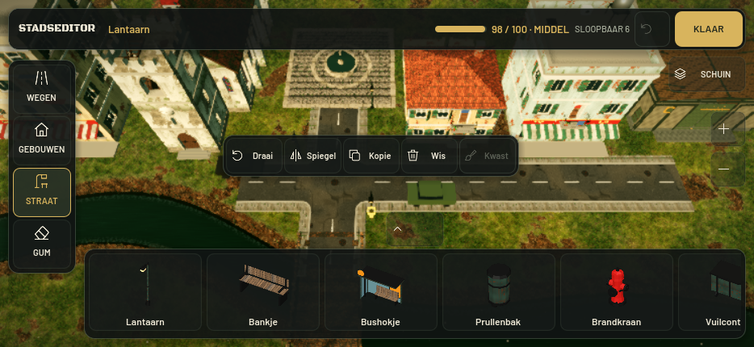
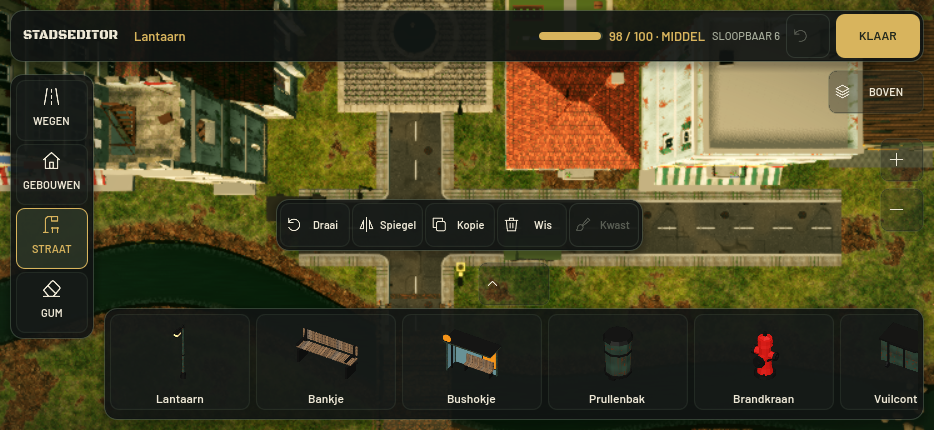

# Stadseditor v86 — schuine camera en rustigere vormgeving

Vervolg op Stadseditor 2.0 v85, vanaf main `07a45e469f27a4b277e4e1fb8c3a6889f9ea585e`.

## De vier gekozen verbeteringen

1. **Schuin / Boven.** De editor start schuin: 60° naar de grond, oftewel 30° uit het lood. De knop rechtsboven op de kaart wisselt tussen SCHUIN en BOVEN. De camera kantelt rond hetzelfde grondpunt op dezelfde afstand; kaartpositie, zoom en plaatsingspreview blijven behouden. De laatst gekozen stand blijft tijdens de lopende spelsessie behouden.
2. **Strakkere typografie.** Black Ops One blijft de editortitel. Alleen de editor gebruikt daarnaast de gewone Barlow Medium/SemiBold, met rustigere objectnamen. De overige spelinterface behoudt haar bestaande lettertypes.
3. **Grotere objectpreviews.** Kaarten zijn 140 punten breed met een groter beeldvlak. Alle 26 gebouw- en straatpreviews zijn opnieuw uit de bestaande modellen gerenderd op 256×256. De camera staat schuin van voren en opzij; de zichtbare modelgrenzen bepalen de uitsnede, ook bij hoge lantaarns en kerktorens. De bestaande placeholders blijven herkenbaar. Het brandkraanicoon gebruikt het intacte begin van zijn eigen animatie. De beelden zijn gecachet; er draaien geen 3D-viewports voor de bibliotheek tijdens het spelen.
4. **Rustigere panelen.** Antraciet/olijfgroen, subtiele transparantie, dunnere randen, afgeronde hoeken en zachte schaduwen. Goud markeert de selectie en KLAAR. De drie bibliotheekstanden blijven werken.

## Bediening bij schuin zicht

Slepen gebruikt de echte projectie op het grondvlak, zodat richting en afstand blijven kloppen bij beide kijkhoeken en alle zoomstanden. Selectie raakt eerst de bestaande botsvorm of, bij decor zonder botsvorm zoals lantaarns, de zichtbare modelgrenzen. Hiervoor worden geen spelbotsingen toegevoegd. Een tweede vinger op een UI-paneel annuleert een begonnen kaartplaatsing.

Wegen, snap, plaatsingsvalidatie, kwast, undo en het bestaande saveformaat blijven behouden. Gebouwen spiegelen blijft volgens de bestaande beperking uitgeschakeld. Wereldindeling, 3D-modellen, voertuigen, AI, wapens, destructie en grafische instellingen zijn in deze wijziging niet aangepast. De aanpassing aan `camera_rig.gd` betreft uitsluitend de editorstand en de interne editorstatus; de gewone speel- en bouwcamera houden hun bestaande instellingen.

## Technische controles

Godot **4.7.2**, Linux. Zie [controles.json](controles.json) voor resultaten en hashes.

```sh
godot --headless --editor --path . --quit
godot --headless --path . -s tests/stad_editor_2_test.gd --fixed-fps 60
godot --headless --path . -s tests/stad_editor_2_test.gd --fixed-fps 60 -- boven
godot --headless --path . -s tests/stad_editor_view_test.gd --fixed-fps 60
```

- De bestaande uitgebreide editortest controleert nu ook de kijkhoekknop en grotere kaartlayout: **3.302 controles per kijkstand**, inclusief 934×430, 844×390, 736×414, 1280×720 en gesimuleerde safe areas.
- De nieuwe kijkhoektest controleert **169 punten**: standaardstand, 60°/90°, behoud van afstand tijdens het kantelen, grondfocus, zoomgrenzen, scherm/wereldprojectie, slepen, selectie van de lantaarn op hoogte, UI-annulering, fonts, previewcache en herstel van de speelcamera. Ook de bovenbalk met 195/100 · TE ZWAAR is met notch op drie iPhone-formaten gecontroleerd.
- Daarnaast zijn 25 bestaande regressies uitgevoerd: stad, stad_editor, stad_lijn, stad_menu, hud_layout, camera, besturing, stick, bouw, smoke, magazijn, magazijn_dak, hotel, kerk, benzine, huis, winkel, ai, tank_mik, granaat, meubels, explosie, schade, loadout en brandkraan.
- De nieuwe tests gebruiken afzonderlijke savepaden per kijkstand en displayserver; ze wijzigen geen eigen opgeslagen stad.

De reeds op main bevestigde ObjectDB/resource-meldingen bij het afsluiten van wereldtests blijven in de logs staan. Ze zijn beschreven in het [v85-rapport](../stadseditor-2/README.md). De afgeronde import en functionele controles hebben geen script- of ontbrekende-resourcefouten. Fysieke Windows- en iPhone-tests zijn hier niet uitgevoerd; softwarerendering is geen mobiele FPS-meting.

## Echte Godot-beelden

Dezelfde bestaande lantaarn, kaartpositie en zoom in beide standen:





[Uitgebreide gebouwbibliotheek](editor-bibliotheek-934x430.png) · [Desktop](editor-desktop-1280x720.png)

```sh
BJ_INSTANT=1 godot --path . --audio-driver Dummy --windowed --resolution 934x430 \
  --disable-render-loop -s tests/stad_editor_view_foto.gd --fixed-fps 60
```

`BJ_EDITOR_CAPTURE_DIR` kiest de uitvoermap; standaard is dat `/tmp/city86-captures`. Het script tekent echte Godot-frames met `RenderingServer.force_draw()`. Het verandert voor de opname uitsluitend de editorcamera en de selectie, en gebruikt een eigen tijdelijk savebestand.

## Fonts

Barlow Medium en SemiBold komen uit [Google Fonts](https://github.com/google/fonts/tree/main/ofl/barlow), ontworpen door Jeremy Tribby, onder de SIL Open Font License. De fonts en [licentie](../../assets/fonts/Barlow-OFL.txt) zijn lokaal opgeslagen. Geen externe fontaanvragen tijdens het spelen.

## Xogot

- Haal main op en controleer v86.
- Kies een lantaarn of bankje en vergelijk SCHUIN met BOVEN, ook ingezoomd.
- Tik op de zichtbare paal, verplaats hem en controleer snap, kopiëren en undo.
- Controleer kaart slepen, pinch, horizontaal vegen en de drie paneelstanden.
- Controleer safe areas en leesbaarheid; sluit de editor en controleer de gewone speelcamera.
