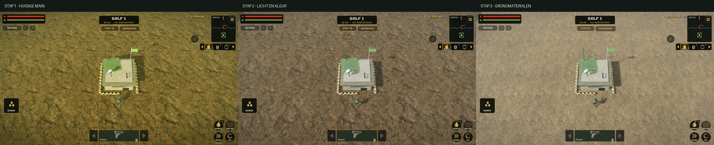
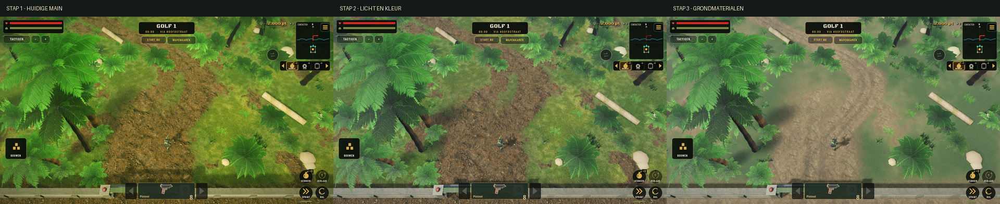

# Jungle graphics — stappen 1, 2 en 3

Branch: `feature/jungle-lighting-terrain-steps-1-3`. Begonnen op actuele main
`045507250d582cf1e805013979239a516d88706d` (inclusief v120 voertuig-HUD en automatische poort).
Deze ronde verandert verlichting, kleur en de bestaande grondmaterialen.
Modellen, camera, AI, HUD, bediening, rij-/wapenbalans en wereldindeling blijven behouden.

## Stap 1 — eerst vastleggen en onderzoeken

Ik heb de actuele main, open branches, atmosfeer, kwaliteitsregelaar, grondshader,
bronkaarten en bestaande tests onderzocht. Daarna zijn vier echte beelden gemaakt:
basis, junglepad, speelbare jeep en zes vijanden met een echt pistoolschot.

Alle vergelijkingen gebruiken de bestaande Main-scène en Camera-node, 1280×720,
kwaliteit Hoog op vaste 80% 3D-resolutie, 58° kijkhoek, 28 m afstand en 45° FOV.
De seed, actorposities en camera zijn vast; wind en automatische kwaliteitsverlaging
staan alleen tijdens de opname stil. Normaal spelen behoudt deze instellingen/regelaar.
De CLI schrijft geen instellingenbestand. De voorbereiding wordt voor het beeld
op 60 minuten gezet, zodat er tijdens de vergelijking geen golf begint.

Gevonden: grind zat in de modder-slot, een roughnesskaart werd als hoogte gebruikt,
grondglans was uitgeschakeld en alleen aarde had een normal map. Warme zon,
groene randtint, mist en verzadiging stapelden zich op. [Baseline](baseline.json).

## Stap 2 — belichting, kleur en schaduw

Ik heb de middagzon van 33° naar 44° hoogte gezet en de richting aangepast. De zon
is neutraler wit, met iets koeler hemellicht voor de schaduwen. Het dagcontrast en
de verzadiging zijn rustiger; minder mist en een lichtere neutrale vignette verminderen
de geelgroene waas. Dusk/night-keuzes en de bestaande regen/mistbediening blijven bestaan.

Hoog gebruikt een 2048-schaduwkaart met twee cascades in plaats van een orthogonale
1024-kaart. Schaduwen zijn duidelijker en minder verspreid. Bias en vervaging zijn
op echte beelden afgesteld. De bestaande kwaliteitstrap kan nog naar één cascade,
1024, kortere schaduwafstand en uiteindelijk geen zonschaduw terugschakelen.
Low blijft zonder zonschaduw; Ultra houdt de bestaande 4096-kaart. Geen nieuwe
lichtnodes, realtime schaduwlichten of reflectieprobes toegevoegd.

SSAO blijft uit op Hoog. Ultra gebruikt kleinere, rustiger ingestelde AO en alleen
waar de renderer die ondersteunt. De game-renderer blijft Forward+ op desktop en
Mobile op iOS; project.godot is niet gewijzigd.

## Stap 3 — de bestaande junglegrond verbeteren

Ik heb de bestaande grondshader uitgebreid met vijf fotografische lagen:

- **Droge aarde:** rustigere microdetails en fijnere schaal in de basis.
- **Grind:** vooral langs paden en overgangsranden.
- **Modder:** echte modderkaart bij oevers en natte plekken.
- **Gras:** eigen oppervlaktestructuur en ruwheid.
- **Bladstrooisel:** natuurlijke afwisseling buiten de verharde routes.

Elke laag heeft albedo plus een gecombineerde kaart: RGB = bestaande OpenGL-normal,
alpha = echte roughness. Normals en ruwheid worden met dezelfde laaggewichten en
UV's gemengd. Detail neemt op afstand subtiel af. Er is geen schijnhoogte uit
roughness meer en geen geometrische verplaatsing.

Zachte rijsporen volgen de bestaande poort-/bosroute. Regen maakt de aarde/modder
donkerder en minder ruw. Dit werkt zowel bij opstarten als na een weerkeuze in het menu.
De vlakke bodem ontvangt schaduwen maar werpt zelf geen schaduw meer: zo ontstaan
geen zelfschaduwstrepen en vervalt die bodemdraw in de shadow passes.

De bestaande river-discard, loopgraaf- en helipaduniforms zijn intact. Bodemhoogte,
440×440 m grondvlak, collider, rij- en looproutes zijn ongewijzigd.

### Bronkwaliteit eerlijk vermeld

De bronfoto's blijven onaangeroerd. De build maakt tien kaarten op de bestaande
1024×1024 opslagmaat. Sommige oude bronnen zijn vóór deze opdracht van 512px
vergroot; die worden **niet** als nieuwe native 1K-details gepresenteerd. Alle huidige
SHA-256's, afwijkende oude manifesthashes, oorspronkelijke URLs en bekende bronmaten
staan in [provenance](../../assets/textures/world_ground/provenance.json).
Deze build schaalt niets op en gebruikt geen betaalde providers of AI-beelden.

## Echte beelden: vóór → licht → grond

Alle PNG's komen rechtstreeks uit Godot. De JPG-overzichten zijn alleen verkleinde
montages van die echte beelden. Camera, framing, kwaliteit en resolutie zijn per rij
gelijk. Belichting verandert bewust tussen stap 1 en 2; tussen stap 2 en 3 blijft
die belichting gelijk. [Opnamegegevens](terrain-captures.json).

| Scène | Vóór | Stap 2 | Stap 3 |
| --- | --- | --- | --- |
| Basis | [PNG](renders/before-base.png) | [PNG](renders/lighting-base.png) | [PNG](renders/terrain-base.png) |
| Jungle | [PNG](renders/before-jungle.png) | [PNG](renders/lighting-jungle.png) | [PNG](renders/terrain-jungle.png) |
| Jeep | [PNG](renders/before-jeep.png) | [PNG](renders/lighting-jeep.png) | [PNG](renders/terrain-jeep.png) |
| Gevecht | [PNG](renders/before-combat.png) | [PNG](renders/lighting-combat.png) | [PNG](renders/terrain-combat.png) |




Extra: [regen bij de echte rivier/brug](renders/rain-river.png). Dit controleert de
oeverovergang, de behouden rivieruitsparing en de natte grond onder regen/mist.

## Tests en kosten

De resultaten staan in [verification.json](verification.json) en [regression-tests.txt](regression-tests.txt).
De nieuwe test controleert echte Godot-imports inclusief behoud van roughness-alpha,
ongewijzigde bodemphysics en ray-hit, 27 tijd/weer/kwaliteitcombinaties, startup-instellingen,
runtime-wisselen, de vier automatische kwaliteitstrappen en behouden uitsparingsuniforms.

De nieuwe shader gebruikt twaalf texturesamplers (voorheen acht), met gepakte normal/
roughness om losse extra samplers te beperken. De opname meldt circa **5,33 MiB extra
texturegeheugen** tegenover de baseline. Dit is de Godot-renderstatistiek, geen gemeten
totale of residente iPhone-VRAM. De 2048-schaduwkaart heeft viermaal zoveel pixels als
1024 en kost daarnaast extra geheugen en een tweede schaduwpass. De exacte iOS-kosten
moeten op het toestel worden gemeten. Er zijn geen nieuwe grondmeshes of extra zichtbare
grond-drawcalls; door de andere zonrichting/cascades verschillen de totale shadow draws.

De opnames zijn gemaakt met Godot 4.6.3 en Mesa llvmpipe/OpenGL Compatibility.
Er zijn geen gemeten mobiele FPS, Metal-tests of fysieke iPhone-tests geclaimd.
Bestaande gear-owner-/ObjectDB/resourcewaarschuwingen bij afsluiten blijven zichtbaar;
de captures bevatten geen script- of shaderfouten.

## Zelf testen in Working Copy en Xogot

1. Fetch en checkout `feature/jungle-lighting-terrain-steps-1-3`; main blijft ongewijzigd.
2. Open hetzelfde project in Xogot en wacht op de texture-import.
3. Start de normale game via `scenes/main.tscn`.
4. Vergelijk Dag/Helder/Hoog bij de bunker, het noordelijke bospad en met de jeep.
5. Kies Regen en controleer de donkere, gladdere grond bij de rivier.
6. Speel een drukke golf; bekijk FPS én resolutieschaal/kwaliteitstrap, niet alleen het
   FPS-getal. Controleer op schaduwflikkering, textureherhaling en zichtbare vijanden.

Fysieke iPhone/Xogot-beoordeling en de keuze of deze stijl bevalt staan nog open.
De PR blijft Draft; er is geen merge uitgevoerd.

## Reproduceren

```sh
python3 tools/build_world_ground.py
godot4 --headless --path . --editor --import --quit
GODOT=godot4 tools/run_tests.sh
BJ_INSTANT=1 godot4 --path . --rendering-method gl_compatibility \
  --windowed --resolution 1280x720 --fixed-fps 60 \
  -s tools/capture_world_graphics.gd -- --stage terrain
```

Voor de regenopname: voeg `--weather rain --view-only river` toe en gebruik `--stage rain`.
Voor de baseline checkout je de vaste basiscommit in een aparte werkmap en gebruik je
dezelfde capturetool. De beelden zijn geen in de game actieve tweede render-/HUD-laag.
De `game-dev`-CLI is niet geïnstalleerd; beeldverwerking en validatie zijn rechtstreeks
met lokale Python/Pillow/Numpy en Godot uitgevoerd, zonder provider- of wrapperreceipts.
